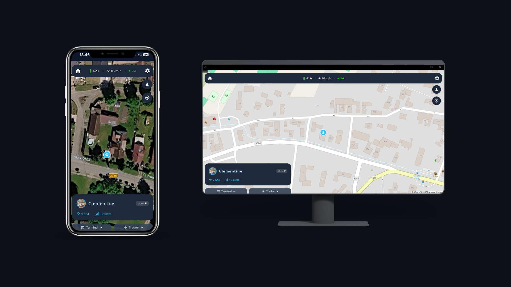
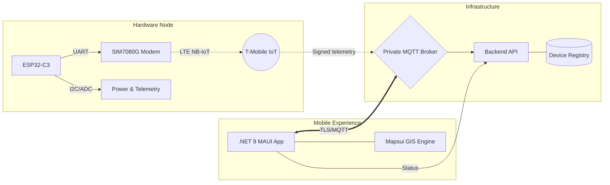
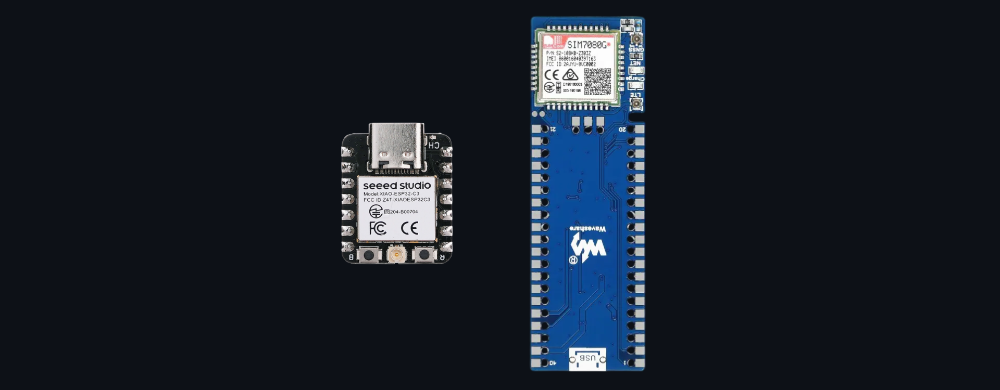
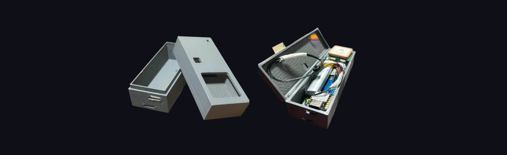
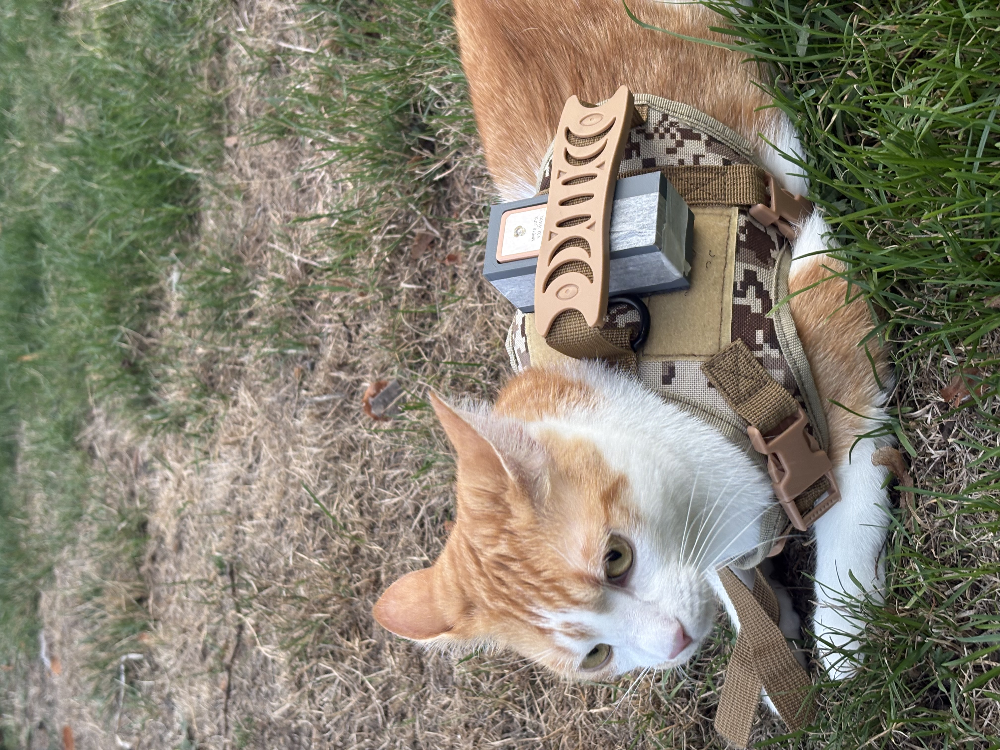

<!-- 
  IMAGE PLACEHOLDERS:
  Replace the paths in the  tags below with your actual images.
  For badges to work fully, replace "USERNAME/REPO" with your actual GitHub path if making public later.
-->

<div align="center">
  
  <h1>Clementine</h1>
  <p><strong>An end-to-end, private cellular tracking ecosystem built for absolute location awareness.</strong></p>
  <p>
    
    
    
    
    
    
    
  </p>

  <details>
    <summary><sub><strong>Support the project</strong> — Clementine is built and maintained independently</sub></summary>
    <br>
    
    <br>
    <sub>Scan with any banking app to send a voluntary contribution.<br>Every bit helps cover hardware, connectivity and server costs. Thank you!</sub>
    <br><br>
  </details>
</div>

> **Clementine is a closed-source ecosystem.** This repository serves as a portfolio showcase. The production source code, infrastructure routing, embedded credentials, and deployment schemas are intentionally strictly private. However, compiled client builds are available in the Releases section. This document details the architectural approach, hardware profile, and UI/UX philosophy from a high-level perspective.

<!-- Hero Image: App UI next to the physical tracker -->
<p align="center">
  
</p>

## About the project

Clementine combines custom hardware, embedded C firmware, a lightweight backend, and a cross-platform mobile app. The goal is to hide the underlying complexity of cellular tracking. While the hardware handles GNSS positioning, network registration, and MQTT communication in the background, the backend keeps track of device identity and status, and the app translates this raw data into a clean, straightforward map interface.

## System Capabilities

- **Real-time GIS Tracking:** High-precision GNSS positioning mapped via the open-source **Mapsui** engine, translating spherical Mercator projections into fluid UI updates.
- **Robust Cellular Telemetry:** Powered by an LTE NB-IoT modem, tracking not just location, but speed, altitude, heading, satellite lock, battery state, and cellular signal strength (Cell ID/RSRP).
- **Remote Configuration:** Change reporting intervals (e.g., 5s to 60s) or operating modes (GPS, Eco, Info, Diag) directly from the app, without physical access to the device. Changes can be applied instantly (Auto) or reviewed first (Manual), and the active mode stays synchronized across every device following the tracker.
- **Multi-Tracker Fleet:** Manage several trackers from a single dashboard with live online/offline indicators, quick renaming, and per-card context actions.
- **QR Pairing:** Add a new tracker in seconds by scanning the QR code included in the box, with a manual code entry as a fallback.
- **Map Styles & Offline Cache:** Switch between OpenStreetMap and satellite imagery, with on-device tile caching and one-tap cache clearing.
- **Biometric App Lock:** Optional fingerprint / face authentication keeps location data private even on a shared device.
- **In-App Updates:** The client checks for new releases on its own and points you to the latest build.
- **Embedded Admin Console:** A built-in diagnostic terminal within the app for sending raw remote commands to the tracker.
- **Graceful Degradation:** Intelligent UI states that explicitly communicate whether data is "Live", "Last Known", or "Offline", with smooth pulse animations to confirm real-time synchronization.
- **Deep Personalization:** Five custom-designed color themes (including Midnight Cyan, AMOLED Black and Forest Pine), Material iconography, an animated splash screen, gesture-driven panels, and tracker identity management with custom profile photos.

## Architectural Overview



The system strictly decouples data acquisition from presentation. The tracker is a lightweight client pushing compact JSON payloads, the backend validates and records device activity, and the `.NET MAUI` application acts as a rich subscriber, parsing the stream and orchestrating the UI on Android and Windows native engines (WinUI3).

**Security by design:** every tracker is provisioned with its own credentials, telemetry is signed at the source and protected against replay, and the client pins the server's certificate. A leaked or spoofed message simply doesn't make it to the map.

## Hardware & Embedded Profile

The physical node is designed for power-efficient, long-term deployment. Before being sealed in its housing, the core relies on highly efficient, miniaturized components.

<!-- Raw Chips Image: ESP32-C3 and SIM7080G side-by-side -->
<p align="center">
  
  <br>
  <em>The core silicon: ESP32-C3 MCU alongside the SIM7080G Cellular/GNSS module.</em>
</p>

| Component | Function |
|---|---|
| **ESP32-C3** | Primary MCU; orchestrates FreeRTOS tasks, power states, and serial bridging. |
| **SIM7080G** | Handles the heavy lifting: CAT-M/NB-IoT network registration and multi-constellation GNSS acquisition. |
| **Connectivity** | T-Mobile IoT SIM paired with specific ceramic GNSS and adhesive LTE antennas for optimized RF performance. |
| **Firmware (C)** | Built on `ESP-IDF`. Manages modem AT-command state machines, graceful reconnects, assisted GNSS for faster fixes, network time sync, battery & power-down reporting, JSON serialization, and signed, authenticated MQTT delivery. |
| **Enclosures** | Fully custom 3D-modeled SLA/FDM casings designed for different deployment profiles. |

<!-- Enclosure Image: The printed tracker assembly -->
<p align="center">
  
  <br>
  <em>Custom 3D-modeled casing designed for maximum durability and precise component fit.</em>
</p>

## Field Deployment

A system like this proves its worth only in the real world. Below is Klementynka equipped with the tracker module during an active field test, demonstrating the physical form factor and real world durability of the 3D printed enclosure.

<!-- Field Usage Image: Klementynka wearing the tracker -->
<p align="center">
  
  <br>
  <em>Active field deployment.</em>
</p>

## Downloads & Releases

While the source code is kept private to protect the underlying infrastructure and embedded secrets, the mobile client is fully built and ready for use.

The current version is **v1.6.2**. Compiled application packages (iterated across multiple versions) are available for free download. You can find the latest Android (APK) build and the Windows installer in the **[Releases](../../releases)** section of this repository. The app notifies you on its own whenever a newer version is available.

## Design & Engineering Principles

- **Quiet Complexity:** The UI hides the complexity of AT commands and MQTT handshakes behind a clean, interactive map.
- **Platform Agnosticism:** Careful XAML architecting ensures the application renders pixel-perfectly on both Android native handlers and the notoriously strict Windows WinUI3 XAML parser.
- **Graceful Uncertainty:** The system never lies. If a signal is lost, the UI explicitly transitions from a green `LIVE` pulse to a gray `LAST KNOWN` state with an elapsed time counter, and finally to `OFFLINE` when no data exists at all.
- **Clean Separation:** The client follows the MVVM pattern: pages only render, view models own state, and dedicated services handle connectivity, parsing, and persistence.
- **Hardware-Software Synergy:** The software themes and 3D enclosure variants are designed as a unified product family.

## A Glimpse of the Codebase

While the core source remains private, the snippet below demonstrates the application's approach to honest status reporting. Instead of pretending the tracker is always live, the view model turns the time since the last valid message into an explicit, human-readable state that the UI binds to directly.

```csharp
// Clementine.ViewModel.MainViewModel.cs (Excerpt)
internal void UpdateLiveStatus()
{
    if (LastMessageTime == DateTime.MinValue)
    {
        LiveStatusText = "OFFLINE";
        return;
    }

    var diff = DateTime.Now - LastMessageTime;

    if (diff.TotalHours >= 1)
    {
        int hours = (int)diff.TotalHours;
        LiveStatusText = $"LAST KNOWN ({hours}h {diff.Minutes}m ago)";
    }
    else
    {
        LiveStatusText = $"LAST KNOWN ({(int)diff.TotalMinutes}m ago)";
    }
}
```

<div align="center">
  <br>
  <sub>Architected, engineered, and designed entirely as a solo venture.</sub>
  <br>
  <sub>v1.6.2 · Private project · Clementine · 2026</sub>
</div>
